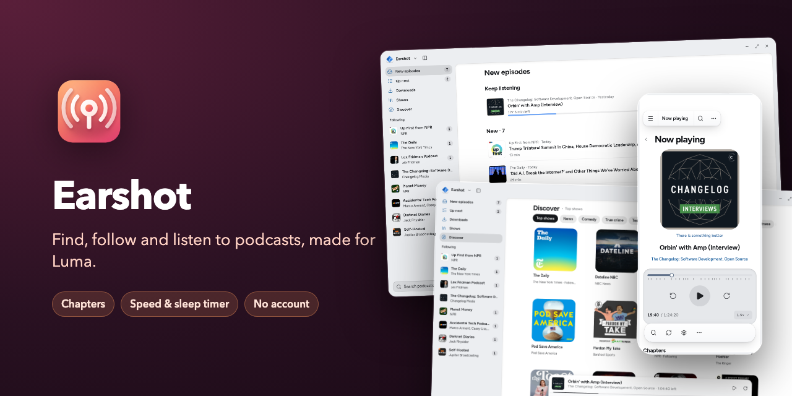
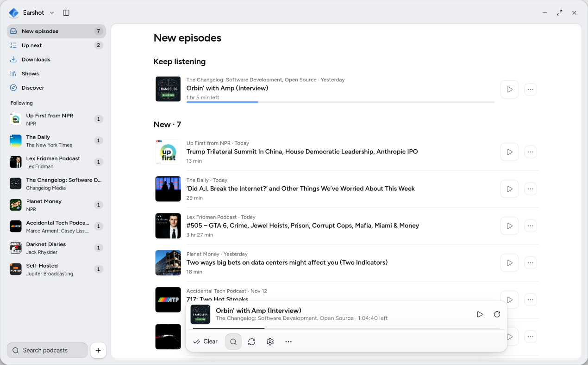
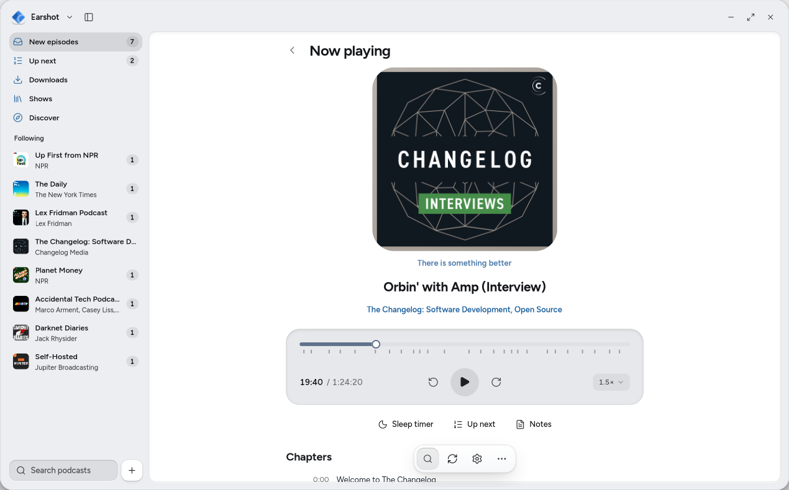
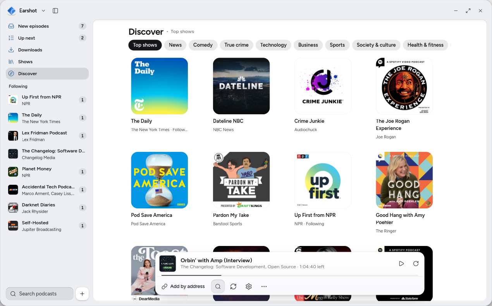
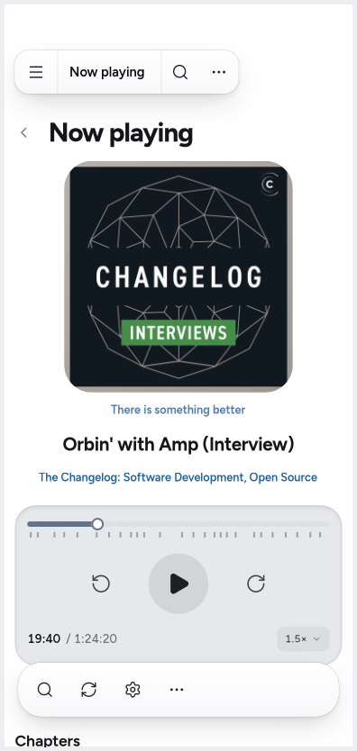

<p align="center">
  
</p>

<p align="center">
  <a href="https://github.com/chartmann1590/earshot/actions/workflows/tests.yml"></a>
  <a href="LICENSE"></a>
  <a href="https://simplyluma.com"></a>
  
</p>

# Earshot

**A podcast app made for [Luma](https://simplyluma.com).** Find shows in the charts or by searching, follow the
ones you like, and their new episodes are waiting for you. Built with LumaUI, it fits a computer, a tablet and a
phone, and keeps playing with the window closed.

<table>
  <tr>
    <td width="50%"></td>
    <td width="50%"></td>
  </tr>
  <tr>
    <td width="50%"></td>
    <td width="50%" align="center"></td>
  </tr>
</table>

## Features

- **Discover**: charts for 15 categories, and search across the whole podcast directory. Paste any feed or a
  show's website to add it.
- **New episodes** from every show you follow in one list, with **Keep listening** for what you started.
- **Up next**: line up episodes and they play through on their own.
- **Speed** from 0.8× to 3× with the voice's pitch kept, remembered for each show.
- **Chapters** (Podcasting 2.0 and Podlove), shown on the scrub and as a list, and **times in the show notes**
  you can tap to jump straight there.
- **Sleep timer** that fades out gently, or stops at the end of the episode or chapter.
- **Downloads** for listening without a connection; finished downloads clean themselves up.
- **Media keys, headphone buttons and the lock screen** control playback (MPRIS).
- **OPML** import and export, so you can bring your shows from any podcast app and take them anywhere.
- No account, no tracking ([privacy policy](PRIVACY.md)).

## Keyboard

| Keys | Does |
| --- | --- |
| <kbd>Ctrl</kbd>+<kbd>Space</kbd> | Play or pause |
| <kbd>Ctrl</kbd>+<kbd>←</kbd> · <kbd>Ctrl</kbd>+<kbd>→</kbd> | Back · Forward |
| <kbd>Ctrl</kbd>+<kbd>[</kbd> · <kbd>Ctrl</kbd>+<kbd>]</kbd> | Slower · Faster |
| <kbd>Ctrl</kbd>+<kbd>L</kbd> | Now playing |
| <kbd>Ctrl</kbd>+<kbd>R</kbd> | Refresh all shows |
| <kbd>Ctrl</kbd>+<kbd>F</kbd> | Search podcasts |
| <kbd>Ctrl</kbd>+<kbd>N</kbd> | Add a show by address |
| <kbd>Ctrl</kbd>+<kbd>O</kbd> · <kbd>Ctrl</kbd>+<kbd>Shift</kbd>+<kbd>S</kbd> | Import · Export subscriptions |
| <kbd>Space</kbd>, <kbd>←</kbd>, <kbd>→</kbd> on Now playing | Play or pause, back, forward |

## Install

Earshot is headed for **Depot**, Luma's app store. Until it's listed, you can build it yourself.

## Build

You need the Luma SDK on `x86_64` (on Luma, or any Linux with Flatpak):

```sh
flatpak remote-add --if-not-exists luma https://dl.simplyluma.com/luma.flatpakrepo
flatpak install luma org.projectluma.Platform//44 org.projectluma.Sdk//44
flatpak-builder --user --install --install-deps-from=luma build-dir flatpak/com.charleshartmann.Earshot.json
flatpak run com.charleshartmann.Earshot
```

## Tests

```sh
python3 -m pytest tests/test_core.py        # feeds, library, OPML, show notes: any Python 3.12+
xvfb-run flatpak run --command=python3 org.projectluma.Sdk//44 tests/test_ui.py   # the real app, in the Luma runtime
luma lint && luma test                      # Luma's app checks
```

## Project layout

```
src/earshot/
  app.py       window, pages, bar and everything you do
  player.py    GStreamer playback (pitch-correct speed)
  mpris.py     media keys and the lock screen
  feeds.py     RSS and Atom, iTunes, Podcasting 2.0 and Podlove tags (no GTK, unit tested)
  store.py     the library in SQLite (no GTK, unit tested)
  net.py       feeds, the directory, artwork and downloads
  notes.py     show notes to safe, tappable text (no GTK, unit tested)
  opml.py      subscriptions in and out
  widgets.py   artwork, episode rows, show tiles and the chapter scrub
data/          desktop file, AppStream metainfo, icon
flatpak/       Flatpak manifest
```

## Contributing

Bug reports and ideas are welcome: [open an issue](https://github.com/chartmann1590/earshot/issues/new/choose).
See [CONTRIBUTING.md](CONTRIBUTING.md) before sending a pull request.

## Licence

[GPL-3.0-or-later](LICENSE). Copyright © 2026 Hartmann Studios. Search and charts use the public Apple Podcasts
directory; Earshot isn't affiliated with Apple.
